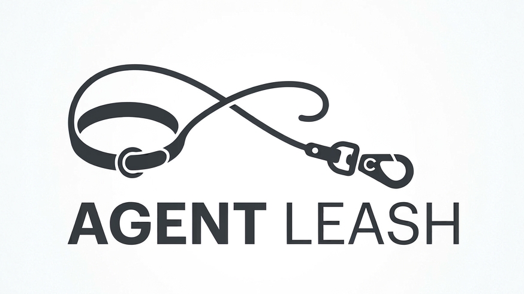

<p align="center">
  
</p>

# Agent Leash

Claude Code plugin that puts your agent on a leash: guards on git (kept in your repo), plus the memory and
rules it reads before it edits. Set it up once per project and keep it current.

## Install

Once per machine:

```bash
claude plugin marketplace add https://github.com/glro-labs/agent-leash.git
claude plugin install agent-leash@agent-leash
```

Inside Claude Code the same commands exist as `/plugin marketplace add` and
`/plugin install`. After installing mid-session, run `/reload-plugins`.

## Quick start

In a project, start `claude` and run:

```
/agent-leash:install   # creates .agents/ and AGENTS.md (safe to re-run)
/agent-leash:memory     # maps the repo into notes the agent reads
/agent-leash:rules      # asks your commit policy, then writes per-area rules
```

Pass an area (`/agent-leash:memory src/payments`) to map just that one, or `--project <dir>` for a sub-project. Each skill asks
before it writes.

Later, to keep an existing project in sync:

```
/agent-leash:update
```

## What you get

- **Guards** on every Bash call, versioned in your repo so they bind the whole team: no
  commits on `main`/`master`, no secrets in commits, no code changes without its memory
  note. You choose which ones at install.
- **Monorepo support:** `--project <dir>` gives `frontend/` or `backend/` a harness of its own.
- **Skills:** `install`, `memory`, `rules`, `update`, `update-{hooks,memory,rules}`.
- **Agents:** `explorer`, `planner`, `implementer`, `test-runner`, `reviewer`.

## Migrating from agent-kit

The project was `agent-kit` and moved to the `glro-labs` org as `agent-leash`. The plugin
and marketplace names changed with it, so commands are now `/agent-leash:*`. On each machine:

```bash
claude plugin uninstall agent-kit@agent-kit
claude plugin marketplace remove agent-kit
claude plugin marketplace add https://github.com/glro-labs/agent-leash.git
claude plugin install agent-leash@agent-leash
```

Then, in each project that already has the context, run `/agent-leash:update`: it drops
the old `agent-kit` entries from `.agents/settings.json` and moves the guards into the repo
(since 0.14 the plugin no longer runs them; until you do, the project has none).

## Uninstall

```bash
claude plugin uninstall agent-leash@agent-leash
claude plugin marketplace remove agent-leash
```

## More

How each guard works, Windows setup, releasing, company mirrors and language:
[GUIDE.md](GUIDE.md).
